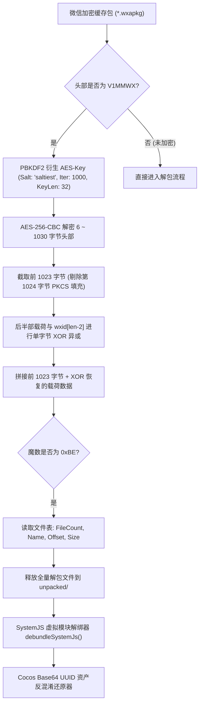

# 东方棋牌 / 普洱小游戏全量核心子游戏逆向与代码工程库

> 宿主程序: `WeChatAppEx.exe` (微信 WMPF 运行时)  
> 主程序 AppID: `wxf4e8b870d6c337ac` (版本号: `46`)  
> 游戏引擎: Cocos Creator 3.x (WebAssembly + SystemJS 模块体系)  
> 平台环境: Windows 64-bit / WeChat Mini-Game Runtime

---

## 1. 核心游戏工程导航与技术矩阵

本工程仓库已对普洱/东方棋牌合集中的 **5 大核心棋牌游戏** 以及 **8 大平台系统子包** 全部完成解密、解包、模块解绑与多媒体资产还原：

### 5 大核心独立游戏包

| 游戏名称 | 对应子包 | 独立工程根目录 | 核心模块数 | 还原多媒体资源 | 核心特色与工程亮点 |
| :--- | :--- | :--- | :---: | :---: | :--- |
| **普洱麻将** | `subGame_mj` | [puer_mahjong_export](file:///d:/gameprojects/mi/puer_mahjong_export) | 92 个 | 全量 3D 牌桌/模型 | 15 字节大端协议头、256B S-Box 密码流代换、39 个 Proto 定义、捉鸡与换三张 |
| **斗地主** | `subGame_ddz` | [doudizhu_export/puer_ddz](file:///d:/gameprojects/mi/doudizhu_export/puer_ddz) | 95 个 | 1,162 个 | 叫地主/抢地主/加倍/出牌状态机、18 种牌型规则表、独立规则引擎、Spine 炸弹/飞机 |
| **捞腌菜** | `subGame_lyc` | [laoyancai_export](file:///d:/gameprojects/mi/laoyancai_export) | 82 个 | 642 个 | 云南两副牌特色竞技、庄闲抢庄/下注/捞牌/通比流程、21 种专属牌型 (510K腿/八炸) |
| **干瞪眼** | `subGame_gdy` | [gandengyan_export](file:///d:/gameprojects/mi/gandengyan_export) | 59 个 | 323 个 | “只能大 1 点”压制机制、2 的特殊压制权、小王/大王万能百搭赖子、轮后摸牌补牌 |
| **耍红牌** | `subGame_shp` | [shuahongpai_export](file:///d:/gameprojects/mi/shuahongpai_export) | 50 个 | 158 个 | 5人4轮比牌竞技、同点/同花/连对/顺子四大主牌型、同牌型暴击机制 (2~5倍)、充能与认输 |

### 8 大平台与大厅支撑系统 (位于 [puer_mahjong_export](file:///d:/gameprojects/mi/puer_mahjong_export))

| 子系统名称 | 对应子包 | 源码目录 | 模块数 | 还原素材数 | 核心功能与业务职责 |
| :--- | :--- | :--- | :---: | :---: | :--- |
| **大厅主系统** | `hall` | [src_hall](file:///d:/gameprojects/mi/puer_mahjong_export/src_hall) | 71 个 | 1,007 个 | 游戏大厅、房间场次路由、个人中心、签到、排行榜、背包商城 |
| **比赛锦标赛** | `match` | [src_match](file:///d:/gameprojects/mi/puer_mahjong_export/src_match) | 18 个 | 12 个 | 赛事报名、定时赛/即开赛、淘汰轮次晋级、赛程表与名次奖励 |
| **福利活动** | `activity` | [src_activity](file:///d:/gameprojects/mi/puer_mahjong_export/src_activity) | 47 个 | 765 个 | 幸运转盘抽奖、每日打牌任务、活跃宝箱、限时返利活动 |
| **礼包商城** | `giftbag` | [src_giftbag](file:///d:/gameprojects/mi/puer_mahjong_export/src_giftbag) | 27 个 | 202 个 | 首充特惠、破产救济金发放、金币银币商城充值接入 |
| **亲友房/茶馆** | `private` | [src_private](file:///d:/gameprojects/mi/puer_mahjong_export/src_private) | 24 个 | 160 个 | 好友开房、房卡/AA消耗、亲友圈茶馆定制规则、战绩回放回查 |
| **桌面通用组件**| `game_common` | [src_game_common](file:///d:/gameprojects/mi/puer_mahjong_export/src_game_common) | 46 个 | 736 个 | 通用玩家头像框、互动道具(鸡蛋/板砖/鲜花)、聊天气泡、牌桌时钟 |
| **登录与鉴权** | `login` | [src_login](file:///d:/gameprojects/mi/puer_mahjong_export/src_login) | 4 个 | 伴生资源 | 微信登录凭证换取、用户鉴权握手、版本热更与资源预加载 |
| **主流程调度** | `main` | [src_main](file:///d:/gameprojects/mi/puer_mahjong_export/src_main) | 12 个 | 伴生资源 | 子包异步按需加载调度、游戏场景生命周期切换、网络异常兜底 |

---

## 2. 微信小游戏 WXAPKG 逆向解密技术管线

本项目自研的完整解密与解包管线已固化在核心工具中：

---

## 3. 各子工程详细技术文档直达

- [普洱麻将完整技术文档 (README.md)](file:///d:/gameprojects/mi/puer_mahjong_export/README.md)
  - 详细包含 15 字节网络协议头规范、S-Box 密码流代换算法、39 个 Protobuf 文件定义表及 Frida 拦截脚本。
- [斗地主完整技术文档 (README.md)](file:///d:/gameprojects/mi/doudizhu_export/puer_ddz/README.md)
  - 详细包含 18 种牌型权重判定、叫抢地主加倍指令流、卡牌字典与独立出牌验证引擎。
- [捞腌菜完整技术文档 (README.md)](file:///d:/gameprojects/mi/laoyancai_export/README.md)
  - 详细包含云南两副牌庄闲流程、510K同花纯腿/杂色假腿等级表、普洱方言特色语音映射。
- [干瞪眼完整技术文档 (README.md)](file:///d:/gameprojects/mi/gandengyan_export/README.md)
  - 详细包含“大 1 点”压制算法、小王大王万能百搭赖子逻辑、补牌轮转与春天惩罚结算。
- [耍红牌完整技术文档 (README.md)](file:///d:/gameprojects/mi/shuahongpai_export/README.md)
  - 详细包含 5 人 4 轮竞技流程、同点/同花/连对/顺子四大主牌型、同牌型暴击机制 (2~5倍)、充能与认输协议。
