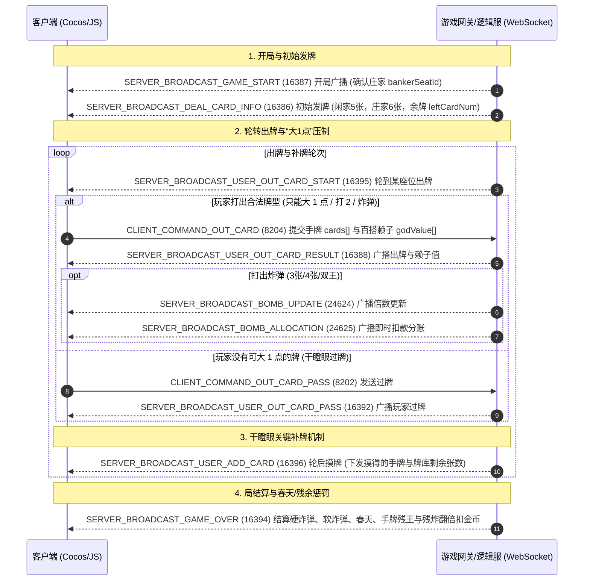

# 普洱/东方棋牌内置「干瞪眼」全量逆向与协议工程文档

> 目标平台: 微信小游戏 (WeChat Mini-Game)  
> 宿主程序: `WeChatAppEx.exe` (WMPF 独立进程)  
> 小程序 AppID: `wxf4e8b870d6c337ac` (版本号: `46`)  
> 子游戏标识: `subGame_gdy` (`_subpackages_subGame_gdy_.wxapkg`)  
> 运行引擎: Cocos Creator 3.x (SystemJS 59 个虚拟模块)

---

## 1. 架构总览与 Mermaid 业务流图

“干瞪眼”以“只能大 1 点”、“2 的特殊压制”、“王牌百搭赖子”及“每轮过牌摸牌”为核心机制。主流程由客户端与 WebSocket 服务端严密驱动：



---

## 2. 目录结构与产物清单

```text
d:/gameprojects/mi/gandengyan_export/
├── raw_wxapkg/                         # 原始微信客户端加密包 (_subpackages_subGame_gdy_.wxapkg)
├── decrypted_wxapkg/                   # 0xBE 标准格式解密包 (335,378 字节)
├── unpacked/                           # 解包后的 subpackages/subGame_gdy/ 资源与脚本
├── src/                                # 59 个解绑格式化的 TS/JS 核心源码模块
│   ├── SubController.js                # 游戏主状态机 (开局、庄家发6张/闲家发5张、补牌、轮转出牌、结算)
│   ├── SubCmd.js                       # 干瞪眼网络命令 ID 定义与协议路由表
│   ├── SubPB.js                        # 二进制 WebSocket 数据流封包与拆包引擎
│   ├── GdyCardTypeAnalyzer.js          # 干瞪眼专属牌型分析与万能百搭赖子算法 (GodCard)
│   ├── SubConstant.js                  # 牌型枚举常量、倒计时、错误码及界面布局配置
│   ├── PokerHelper2.js                 # 智能出牌选牌推荐与管牌逻辑
│   ├── subHanderCardsCtr.js            # 玩家手牌触摸排布、抬起与滑选控制
│   ├── subOperationPrefabCtr.js        # 出牌、不出、提示按钮控制器
│   ├── subGameOverPrefabCtr.js         # 局结算面板 (春天判定、残王与残炸惩罚翻倍)
│   └── ...                             # 时钟、表情、快捷语音、筹码动效等组件
├── assets_named/                       # 323 个规范命名的原生多媒体资源
│   ├── audio/                          # 完整音效库
│   │   ├── card/                       # 男/女声报牌音效、出牌声、过牌声
│   │   ├── effect/                     # 炸弹轰炸声、飞机音效、金币飞行动效
│   │   ├── chatxiaobo/                 # 普洱本地男声特色方言语音 (9 条)
│   │   └── chatxiaoya/                 # 普洱本地女声特色方言语音 (9 条)
│   ├── image/                          # 牌桌背景、头像框、扑克牌面贴图、加倍图标
│   └── spineAni/                       # 炸弹、春天动画 Spine 贴图与骨骼配置
├── remote_assets/                      # 远程动态下载的未混淆缓存包
└── gdy_card_dict.js                    # Node.js 干瞪眼卡牌解析与压制规则校验工具
```

---

## 3. 干瞪眼核心玩法机制与牌型体系 (`GdyCardTypeAnalyzer.ts`)

| 牌型枚举 (`CARD_TYPE`) | 数值 | 牌型名称 | 判定条件与特殊规则 |
| :--- | :---: | :--- | :--- |
| `kCT_GDY_SINGLE` | 0 | 单牌 | **只能压大 1 点** (如 6 只能压 5；2 可压任意单牌；大小王不能单出) |
| `kCT_GDY_DOUBLE` | 1 | 对子 | **只能压大 1 点** (如 88 只能压 77；22 可压任意对子) |
| `kCT_GDY_ONE_LINE` | 2 | 单顺(连牌) | 3 张及以上相连单牌 (不可包含 2 和王) |
| `KCT_GDY_DOUBLE_LINE` | 3 | 双顺(连对) | 2 对及以上相连对子 (不可包含 2 和王) |
| `KCT_GDY_SMALL_BOMB_GOD`| 4.5 | 软小炸弹 | **3 张牌点相同，且含有大小王赖子** |
| `KCT_GDY_SMALL_BOMB` | 5 | 硬小炸弹 | **3 张纯相同牌** (如 777，压制所有单牌/对子/顺子) |
| `KCT_GDY_BIG_BOMB_GOD` | 5.5 | 软大炸弹 | **4 张牌点相同，且含有大小王赖子** |
| `kCT_GDY_BIG_BOMB` | 6 | 硬大炸弹 | **4 张纯相同牌** (压制小炸弹) |
| `kCT_GDY_MISSILE` | 7 | 火箭(双王) | **大王 + 小王**，全场最高压制级别 |

---

## 4. 全量网络协议指令表 (`SubCmd.ts` / `SubPB.ts`)

| 命令常量 | Cmd ID | 方向 | 数据体序列化规范与说明 |
| :--- | :---: | :---: | :--- |
| `CLIENT_COMMAND_OUT_CARD` | 8204 | C -> S | `writeByte(cardsLen)` + `cards[]` + `writeByte(godLen)` + `godVal[]`: 打出的手牌与百搭赖子替换值 |
| `CLIENT_COMMAND_OUT_CARD_PASS` | 8202 | C -> S | 过牌请求 (不出) |
| `SERVER_BROADCAST_GAME_START` | 16387 | S -> C | 开局广播，下发本局庄家座位 `bankerSeatId` |
| `SERVER_BROADCAST_DEAL_CARD_INFO` | 16386 | S -> C | 初始发牌 (闲家5张，庄家6张，牌库余牌 `leftCardNum`) |
| `SERVER_BROADCAST_USER_OUT_CARD_START` | 16395 | S -> C | 轮到某座位出牌广播与倒计时 |
| `SERVER_BROADCAST_USER_OUT_CARD_RESULT` | 16388 | S -> C | 广播玩家打出的牌、牌型 ID `cardType` 及替换的赖子值 `godValue` |
| `SERVER_BROADCAST_USER_OUT_CARD_PASS` | 16392 | S -> C | 广播某座位玩家选择过牌 |
| `SERVER_BROADCAST_USER_ADD_CARD` | 16396 | S -> C | **关键补牌广播**: 摸牌玩家 `seatId`、摸得的卡牌 `cards` 与牌库剩余张数 `leftCardNum` |
| `SERVER_BROADCAST_BOMB_UPDATE` | 24624 | S -> C | 广播炸弹打出后的公共倍数更新 |
| `SERVER_BROADCAST_BOMB_ALLOCATION`| 24625 | S -> C | 广播炸弹即时分账金币划转 |
| `SERVER_BROADCAST_GAME_OVER` | 16394 | S -> C | 局结算: 硬炸弹数 `hardBomb`、软炸弹数 `softBomb`、火箭 `rocket`、春天 `spring`、各家手牌余牌及残王惩罚 |

---

## 5. 卡牌工具与运行示例 (`gdy_card_dict.js`)

可在 Node.js 中直接引入 [gdy_card_dict.js](file:///d:/gameprojects/mi/gandengyan_export/gdy_card_dict.js) 进行卡牌展示：

```javascript
const { parseGdyHand, formatGdyHand } = require('./gdy_card_dict.js');

// 示例: 小王(赖子) + 大王 + 22 + 5
const handBytes = [78, 79, 2, 18, 5];
console.log('手牌明细:', formatGdyHand(handBytes)); // ★大王 ★小王 ♣2 ♦2 ♦5
```

---

## 6. 核心模块与实用工具快速入口

- **主控制器**: [`SubController.js`](file:///d:/gameprojects/mi/gandengyan_export/src/SubController.js)
- **百搭与牌型分析**: [`GdyCardTypeAnalyzer.js`](file:///d:/gameprojects/mi/gandengyan_export/src/GdyCardTypeAnalyzer.js)
- **网络协议路由**: [`SubCmd.js`](file:///d:/gameprojects/mi/gandengyan_export/src/SubCmd.js)
- **网络封包拆包**: [`SubPB.js`](file:///d:/gameprojects/mi/gandengyan_export/src/SubPB.js)
- **卡牌字典工具**: [`gdy_card_dict.js`](file:///d:/gameprojects/mi/gandengyan_export/gdy_card_dict.js)
- **原生多媒体资产**: [assets_named](file:///d:/gameprojects/mi/gandengyan_export/assets_named)
