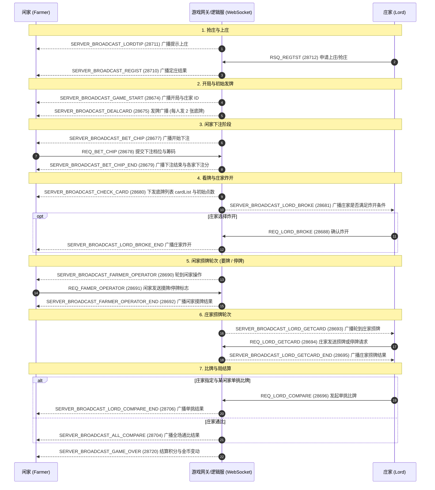

# 普洱/东方棋牌内置「捞腌菜」全量逆向与协议工程文档

> 目标平台: 微信小游戏 (WeChat Mini-Game)  
> 宿主程序: `WeChatAppEx.exe` (WMPF 独立进程)  
> 小程序 AppID: `wxf4e8b870d6c337ac` (版本号: `46`)  
> 子游戏标识: `subGame_lyc` (`_subpackages_subGame_lyc_.wxapkg`)  
> 运行引擎: Cocos Creator 3.x (SystemJS 82 个虚拟模块)

---

## 1. 架构总览与 Mermaid 业务流图

“捞腌菜”是云南极具地域特色的多副牌竞技玩法（庄家 vs 多闲家）。游戏流转高度严谨，涉及抢庄、下注、补牌（捞牌）与通比结算：



---

## 2. 目录结构与产物清单

```text
d:/gameprojects/mi/laoyancai_export/
├── raw_wxapkg/                         # 原始微信客户端加密包 (_subpackages_subGame_lyc_.wxapkg)
├── decrypted_wxapkg/                   # 0xBE 标准格式解密包 (400,486 字节)
├── unpacked/                           # 解包后的 subpackages/subGame_lyc/ 资源与脚本
├── src/                                # 82 个解绑格式化的 TS/JS 核心源码模块
│   ├── lycController.js                # 游戏主状态机 (上庄、发牌、下注、捞牌、比牌、结算)
│   ├── lycCmd.js                       # 捞腌菜全量网络命令 ID 定义与协议路由
│   ├── lycPB.js                        # 二进制 WebSocket 数据流封包与拆包引擎
│   ├── Card4.js                        # 捞腌菜牌面字节换算 (A~K, 大小王, 听用牌)
│   ├── CardConfig3.js                  # 21 种专属牌型配置表 (510K腿、四炸至八炸、三王四王)
│   ├── lycPokerhHelper.js              # 牌型大小比对、管牌与出牌提示算法
│   ├── BankerMgr3.js                   # 庄家/闲家轮换管理器
│   ├── lycBetPanelPrefabCtr.js         # 闲家下注操作面板 (倍数/筹码)
│   ├── lycHanderCardsCtr.js            # 玩家手牌渲染与触控控制
│   └── ...                             # 结算面板、时钟、表情、快捷语音等组件
├── assets_named/                       # 642 个规范命名的原生多媒体资源
│   ├── audio/                          # 音效库
│   │   ├── cardOperate/                # 男/女声捞牌、补牌、要牌、停牌、比牌语音
│   │   ├── cardPoint/                  # 0 点 ~ 9 点点数报音
│   │   ├── cardType/                   # 纯腿、假腿、四炸至八炸、大小王牌型报音
│   │   ├── chatxiaobo/                 # 普洱本地男声特色方言语音包 (9 条)
│   │   ├── chatxiaoya/                 # 普洱本地女声特色方言语音包 (9 条)
│   │   └── effect/                     # 下注、炸开、洗牌、金币飞行动效声音
│   ├── image/                          # 牌桌背景、筹码贴图、奖牌、走水图标
│   └── spineAni/                       # 骨骼动画贴图与配置
├── remote_assets/                      # 远程动态下载的未混淆缓存包
└── lyc_card_dict.js                    # Node.js 捞腌菜卡牌映射与解析工具
```

---

## 3. 21 种捞腌菜专属牌型与等级排序 (`CardConfig3.ts`)

捞腌菜使用两副牌，等级由低到高如下：

| 等级 ID | 牌型名称 | 组合构成说明 | 压制与特征 |
| :---: | :--- | :--- | :--- |
| **1** | 单牌 | 任意 1 张单牌 | 点数：大王 > 小王 > 2 > A > K > ... > 3 |
| **2** | 对子 | 2 张点数相同的牌 | 22 最大，33 最小 |
| **3** | 单龙 | 3 张及以上相连单牌 | 连牌不包含 2 和王 (如 7-8-9) |
| **4** | 双龙 | 3 对及以上连续对子 | 连对不包含 2 和王 (如 33-44-55) |
| **6** | 三张炮 | 3 张点数相同 | 压制单牌、对子、单龙 |
| **7** | 510K假腿 | 杂色 5、10、K 各一张 | 压制三张炮 |
| **8** | 大小王 | 1 张大王 + 1 张小王 | 压制假腿 |
| **9~12**| 510K纯腿 | 同花色 5、10、K 各一张 | 顺序：红桃 > 黑桃 > 方块 > 梅花纯腿 |
| **13** | 双小王 | 2 张小王 | 压制纯腿 |
| **14** | 双大王 | 2 张大王 | 压制双小王 |
| **15** | 四炸 | 4 张点数相同的牌 | 开始进入炸弹级别 |
| **16** | 五炸 | 5 张点数相同的牌 | 压制四炸 |
| **17** | 三王 | 3 张王牌 (大小王混合) | 压制五炸 |
| **18** | 六炸 | 6 张点数相同的牌 | 压制三王 |
| **19** | 七炸 | 7 张点数相同的牌 | 压制六炸 |
| **20** | 四王 | 4 张王牌 (双大王+双小王) | 压制七炸 |
| **21** | 八炸 | 8 张点数相同的牌 | **全场最高封顶牌型** |

---

## 4. 全量网络通信指令表 (`lycCmd.ts` / `lycPB.ts`)

| 命令常量 | Cmd ID | 方向 | 数据体格式与业务说明 |
| :--- | :---: | :---: | :--- |
| `SERVER_BROADCAST_REGIST` | 28710 | S -> C | 广播玩家申请上庄 / 抢庄 |
| `RSQ_REGTST` | 28712 | C -> S | `writeInt(flag)`: 客户端抢庄/下庄请求 |
| `SERVER_BROADCAST_LORDTIP` | 28711 | S -> C | 广播提示轮换庄家 |
| `SERVER_BROADCAST_GAME_START` | 28674 | S -> C | 开局广播，确定庄家 `landlordUserId` |
| `SERVER_BROADCAST_DEALCARD` | 28675 | S -> C | 发牌阶段 (每人发 2 张底牌，剩余牌库 `remainCardNum`) |
| `SERVER_BROADCAST_BET_CHIP` | 28677 | S -> C | 广播闲家开始下注 (下注倒计时) |
| `REQ_BET_CHIP` | 28678 | C -> S | `writeShort(flag)`: 闲家选择下注档位 |
| `SERVER_BROADCAST_BET_CHIP_END`| 28679 | S -> C | 广播玩家下注金额 `betChipMoney` 与全部完成标志 |
| `SERVER_BROADCAST_CHECK_CARD` | 28680 | S -> C | 玩家看牌: 下发牌列表 `cardList` 及点数 `cardPoint` |
| `SERVER_BROADCAST_LORD_BROKE` | 28681 | S -> C | 广播庄家是否炸开 (`canBroke`) |
| `REQ_LORD_BROKE` | 28688 | C -> S | 庄家确认炸开操作 |
| `SERVER_BROADCAST_FARMER_OPERATOR` | 28690 | S -> C | 轮到闲家操作 (闲家要牌/捞牌) |
| `REQ_FAMER_OPERATOR` | 28691 | C -> S | `writeShort(flag)`: 闲家捞牌/停牌操作 |
| `SERVER_BROADCAST_FARMER_OPERATOR_END` | 28692 | S -> C | 广播闲家摸牌结果与新摸手牌 |
| `SERVER_BROADCAST_LORD_GETCARD`| 28693 | S -> C | 广播庄家开始捞牌阶段 |
| `REQ_LORD_GETCARD` | 28694 | C -> S | `writeShort(flag)`: 庄家捞牌/停牌操作 |
| `REQ_LORD_COMPARE` | 28696 | C -> S | `writeInt(userId)`: 庄家指定与某闲家比牌 |
| `SERVER_BROADCAST_LORD_COMPARE_END` | 28706 | S -> C | 庄闲单挑比牌结果下发 |
| `SERVER_BROADCAST_ALL_COMPARE`| 28704 | S -> C | 庄家与所有闲家通比结算 |
| `SERVER_BROADCAST_GAME_OVER` | 28720 | S -> C | 局结算 (各玩家金币变化 `turnMoney`、走水、总额) |

---

## 5. 卡牌工具与运行示例 (`lyc_card_dict.js`)

可在 Node.js 中直接引入 [lyc_card_dict.js](file:///d:/gameprojects/mi/laoyancai_export/lyc_card_dict.js) 进行卡牌展示：

```javascript
const { parseLycHand, formatLycHand } = require('./lyc_card_dict.js');

// 示例: 红桃 5-10-K 纯腿 + 大王
const handBytes = [37, 42, 45, 79]; // 红桃5, 红桃10, 红桃K, 大王
console.log('手牌明细:', formatLycHand(handBytes)); // ♥5 ♥10 ♥K ★大王
```

---

## 6. 核心模块与实用工具快速入口

- **主控制器**: [`lycController.js`](file:///d:/gameprojects/mi/laoyancai_export/src/lycController.js)
- **协议命令定义**: [`lycCmd.js`](file:///d:/gameprojects/mi/laoyancai_export/src/lycCmd.js)
- **网络封包与拆包**: [`lycPB.js`](file:///d:/gameprojects/mi/laoyancai_export/src/lycPB.js)
- **牌型与等级规则**: [`CardConfig3.js`](file:///d:/gameprojects/mi/laoyancai_export/src/CardConfig3.js)
- **卡牌字典工具**: [`lyc_card_dict.js`](file:///d:/gameprojects/mi/laoyancai_export/lyc_card_dict.js)
- **原生多媒体资产**: [assets_named](file:///d:/gameprojects/mi/laoyancai_export/assets_named) (配音、点数报音、Spine 贴图)
