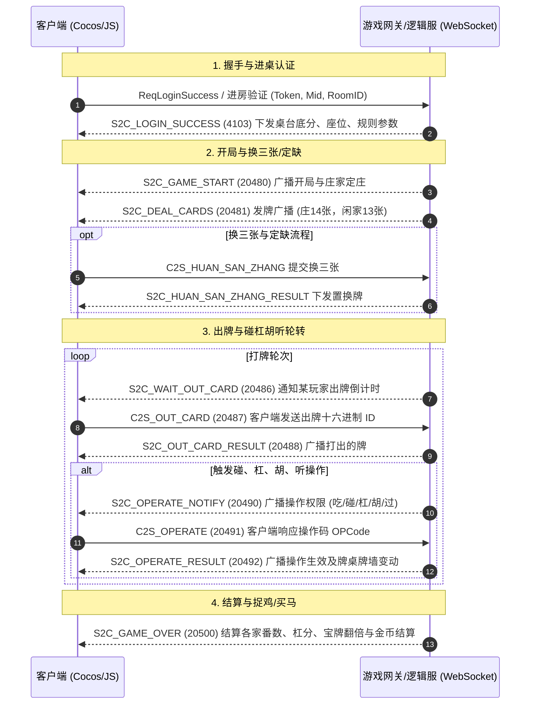

# 普洱麻将 (东方棋牌) 全量逆向与协议工程文档

> 目标平台: 微信小游戏 (WeChat Mini-Game)  
> 宿主程序: `WeChatAppEx.exe` (WMPF 独立进程)  
> 小程序 AppID: `wxf4e8b870d6c337ac` (版本号: `46`)  
> 运行引擎: Cocos Creator 3.x (WebAssembly + SystemJS 模块架构)

---

## 1. 架构总览与 Mermaid 业务流图

普洱麻将采用 WebSocket 长连接进行双向通讯。通信采用 **15 字节大端协议头 + S-Box 密码流代换 + Google Protobuf 二进制序列化**。



---

## 2. 目录结构与导出文件清单

```text
d:/gameprojects/mi/puer_mahjong_export/
├── src_subGame_mj/                     # ★ 普洱麻将核心业务源码 (92 个 TS/JS 格式化模块)
│   ├── FXJController3.js               # 桌台游戏主控制器、状态机分发、重连恢复
│   ├── CardPlayManeger3.js             # 手牌出牌、碰杠牌组排布、滑选出牌交互
│   ├── CardConfigs3.js                 # 牌面十六进制映射、3D 牌桌尺寸、玩家方位坐标
│   ├── FXJCmd3.js                      # 全量网络命令 ID 映射表 (绑定 Protobuf 与事件)
│   ├── FXJConfig3.js                   # 麻将操作码 OPCode (吃碰杠胡听过) 与番型规则
│   ├── FXJConstant3.js                 # 游戏状态、音效配置、快捷聊天与互动表情
│   ├── MajiangUtil3.js                 # 听牌检测、算番规则与胡牌条件算法
│   ├── ZhuoJi3.js                      # 云南/普洱特色“捉鸡/翻牌”广播与动画控制器
│   ├── BaoPaiTop3.js                   # 宝牌/财神赖子牌界面展示与同步
│   └── ...                             # 结算界面、换三张、补花、听牌提示组件
├── src_base/                           # ★ 底层通用网络与通信架构 (148 个格式化模块)
│   ├── GSocket.js                      # WebSocket 长连接心跳维护与断线自动重连
│   ├── GlobalProtocol.js               # 15 字节大端协议头组装与校验和运算
│   ├── Encrypto.js                     # 256 字节单字节 S-Box 代换密码流引擎
│   ├── GCache.js                       # 用户身份、资产、房间状态中央缓存
│   └── BaseProtobuf.js                 # Protobuf 编解码抽象基类
├── src_game/                           # 通用游戏外围组件 (87 个格式化模块)
│
├── src_hall/                           # ★ 大厅主系统源码 (71 个格式化模块)
│   ├── HallController.js               # 大厅主状态机、选场路由、快速开始
│   ├── UserInfoController.js           # 玩家信息卡、头像更换、战绩统计
│   └── ...                             # 签到、商城、邮件、公告、排行榜组件
├── src_match/                          # ★ 比赛/锦标赛系统源码 (18 个格式化模块)
│   ├── MatchController.js              # 锦标赛生命周期、轮次晋级调度
│   └── ...                             # 赛程表、淘汰结算、名次排行榜
├── src_activity/                       # ★ 福利活动系统源码 (47 个格式化模块)
│   └── ...                             # 幸运大转盘、每日任务宝箱、打牌连胜奖励
├── src_giftbag/                        # ★ 礼包与商城系统源码 (27 个格式化模块)
│   └── ...                             # 首充特惠、破产救济金领取、充值回调
├── src_private/                        # ★ 亲友圈/好友房系统源码 (24 个格式化模块)
│   └── ...                             # AA/房主建房、茶馆管理、规则定制、录像回放
├── src_game_common/                    # ★ 游戏桌面通用组件源码 (46 个格式化模块)
│   └── ...                             # 通用互动道具(鸡蛋/板砖)、表情包、快捷语音
├── src_login/                          # ★ 登录鉴权源码 (4 个格式化模块)
├── src_main/                           # ★ 主加载调度器源码 (12 个格式化模块)
│
├── assets_named/                       # ★ 3,134 个反混淆规范命名的原生多媒体资产
│   ├── hall/                           # 大厅视觉资源 (1,007 个文件: 场次卡片、UI图标、背景)
│   ├── match/                          # 比赛场资源 (12 个文件: 奖杯、晋级图)
│   ├── activity/                       # 活动资源 (765 个文件: 轮盘贴图、活动海报)
│   ├── giftbag/                        # 礼包资源 (202 个文件: 金币银币、宝箱特惠)
│   ├── private/                        # 亲友房资源 (160 个文件: 房卡图标、茶馆UI)
│   ├── game_common/                    # 桌面公共资源 (736 个文件: 头像框、互动道具动效)
│   └── audio_game/                     # 游戏公共音效 (252 个文件: 点击声、金币声、背景音乐)
│
├── proto/                              # ★ 39 个还原导出的原生 Google Protobuf 定义文件
│   ├── Common.proto                    # 通用网络响应、玩家基本信息
│   ├── Game.proto                      # 麻将出牌、碰杠、发牌载荷定义
│   └── S2C_*.proto                     # 登录、重连、结算等数据结构
├── raw_wxapkg/                         # 20 个带 V1MMWX 头部的微信原始加密包
├── decrypted_wxapkg/                   # 20 个 0xBE 标准格式解密镜像
├── unpacked/                           # 官方 20 个子包解包后的完整 Cocos 资产目录
├── remote_assets/                      # 远程动态下载的 3D 麻将模型、材质与 Spine 贴图
├── packet_codec.js                     # 独立可运行的 15 字节协议头 + S-Box 编解码工具
├── card_dict.js                        # 麻将牌值十六进制与万条筒字花色映射字典
├── game_protocol_engine.js             # 整合 S-Box 与 Protobuf 的全功能收发仿真引擎
├── live_packet_inspector.js            # 抓包抓取到的数据流解码分析工具
└── frida_hook_mahjong.js               # 微信进程 WeChatAppEx.exe 内存拦截与实时明牌脚本
```

---

## 3. 普洱麻将十六进制卡牌编码映射 (`card_dict.js`)

普洱麻将采用单字节十六进制编码牌面值：
- **高 4 位 (`byte >> 4`)**: 牌系花色分类
- **低 4 位 (`byte & 0x0F`)**: 牌点数值 (1 ~ 9)

| 类别 | 范围 (Hex) | 范围 (Dec) | 牌面明细 |
| :--- | :---: | :---: | :--- |
| **万字牌** | `0x01` ~ `0x09` | 1 ~ 9 | 一万、二万、三万、四万、五万、六万、七万、八万、九万 |
| **条字牌** | `0x11` ~ `0x19` | 17 ~ 25 | 一条、二条、三条、四条、五条、六条、七条、八条、九条 |
| **筒字牌** | `0x21` ~ `0x29` | 33 ~ 41 | 一筒、二筒、三筒、四筒、五筒、六筒、七筒、八筒、九筒 |
| **风字牌** | `0x31` ~ `0x34` | 49 ~ 52 | 东风 (`0x31`)、南风 (`0x32`)、西风 (`0x33`)、北风 (`0x34`) |
| **箭字牌** | `0x35` ~ `0x37` | 53 ~ 55 | 红中 (`0x35`)、发财 (`0x36`)、白板 (`0x37`) |
| **四季牌** | `0x41` ~ `0x44` | 65 ~ 68 | 春 (`0x41`)、夏 (`0x42`)、秋 (`0x43`)、冬 (`0x44`) |
| **四君子** | `0x45` ~ `0x48` | 69 ~ 72 | 梅 (`0x45`)、兰 (`0x46`)、竹 (`0x47`)、菊 (`0x48`) |

---

## 4. 底层通信协议与 S-Box 加密体系

### 15 字节大端协议头定义 (`GlobalProtocol.ts`)

| 偏移 (Offset) | 长度 | 类型 | 字段含义与说明 |
| :---: | :---: | :---: | :--- |
| `0x00` | 4B | `Int32BE` | 封包长度减 4 (`packetLen - 4`) |
| `0x04` | 2B | `ASCII` | 魔数校验固定为 `'Q'`, `'E'` (`0x5145`) |
| `0x06` | 1B | `Uint8` | 主版本号 (固定为 `1`) |
| `0x07` | 1B | `Uint8` | 次版本号 (固定为 `0`) |
| `0x08` | 4B | `Int32BE` | **命令字 ID (Cmd ID)** (例如出牌 `20487`) |
| `0x0C` | 2B | `Int16BE` | 消息序号 (自增 Sequence) |
| `0x0E` | 1B | `Uint8` | **校验和**: 发送端 `(1 + ~sum) & 0xFF`，接收端校验 `sum == 0` |
| `0x0F` | N 字节 | `Bytes` | 经 S-Box 代换后的 Protobuf 消息载荷 |

### 核心编解码调用示例

在项目根目录下可直接调用 [packet_codec.js](file:///d:/gameprojects/mi/puer_mahjong_export/packet_codec.js) 进行数据包模拟：

```javascript
const { encodePacket, decodePacket } = require('./packet_codec.js');

// 1. 构造一个出牌请求包 (C2S_OUT_CARD: 20487, 打出八万: 0x08)
const cardPayload = Buffer.from([0x08]);
const packet = encodePacket(20487, cardPayload);
console.log('生成的网络流 (Hex):', packet.toString('hex'));

// 2. 解析收到的二进制流
const decoded = decodePacket(packet);
console.log('解密校验状态:', decoded.verified, '命令字:', decoded.cmd);
```

---

## 5. 核心模块与实用工具快速入口

- **主控制器**: [`FXJController3.js`](file:///d:/gameprojects/mi/puer_mahjong_export/src_subGame_mj/FXJController3.js)
- **大厅控制器**: [`src_hall`](file:///d:/gameprojects/mi/puer_mahjong_export/src_hall)
- **协议路由表**: [`FXJCmd3.js`](file:///d:/gameprojects/mi/puer_mahjong_export/src_subGame_mj/FXJCmd3.js)
- **协议编解码**: [`packet_codec.js`](file:///d:/gameprojects/mi/puer_mahjong_export/packet_codec.js)
- **实时抓包解码器**: [`live_packet_inspector.js`](file:///d:/gameprojects/mi/puer_mahjong_export/live_packet_inspector.js)
- **Frida 实时 Hook 脚本**: [`frida_hook_mahjong.js`](file:///d:/gameprojects/mi/puer_mahjong_export/frida_hook_mahjong.js)
- **还原原生多媒体资产**: [assets_named](file:///d:/gameprojects/mi/puer_mahjong_export/assets_named) (大厅、活动、比赛、亲友房共 3,134 个文件)
