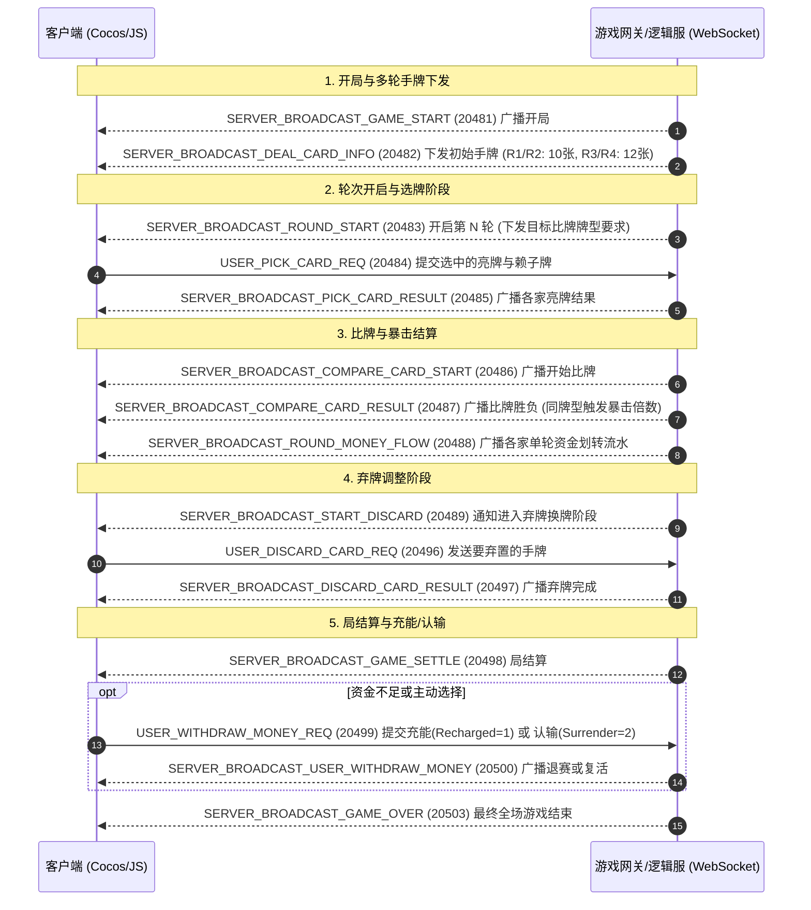

# 普洱/东方棋牌内置「耍红牌」全量逆向与协议工程文档

> 目标平台: 微信小游戏 (WeChat Mini-Game)  
> 宿主程序: `WeChatAppEx.exe` (WMPF 独立进程)  
> 小程序 AppID: `wxf4e8b870d6c337ac` (版本号: `46`)  
> 子游戏标识: `subGame_shp` (`_subpackages_subGame_shp_.wxapkg`)  
> 运行引擎: Cocos Creator 3.x (SystemJS 50 个虚拟模块)

---

## 1. 架构总览与 Mermaid 业务流图

“耍红牌”是云南经典的多人竞技扑克游戏（最多 5 人对战），共打 4 轮（前两轮各发 10 张牌，后两轮各发 12 张牌）。核心机制为**选牌组合、同型比牌、弃牌重构、同牌型暴击**以及**充能/认输退赛**：



---

## 2. 目录结构与产物清单

```text
d:/gameprojects/mi/shuahongpai_export/
├── raw_wxapkg/                         # 原始微信客户端加密包 (_subpackages_subGame_shp_.wxapkg)
├── decrypted_wxapkg/                   # 0xBE 标准格式解密包 (388,221 字节)
├── unpacked/                           # 解包后的 subpackages/subGame_shp/ 资源与脚本
├── src/                                # 50 个解绑格式化的 TS/JS 核心源码模块
│   ├── shpController.js                # 游戏主状态机 (进房、多轮选牌、比牌、弃牌、退赛结算)
│   ├── ShpRules.js                     # 牌型定义、算番倍数表、赖子百搭算法、比牌大小逻辑
│   ├── shpCmd.js                       # 耍红牌全量网络命令 ID 定义与协议路由
│   ├── shpComparePrefabCtr.js          # 比牌核心动画与特效 (暴击光束、各亮牌位倍数)
│   ├── ShpCritBeamEffect.js            # 暴击光束光效控制器
│   ├── shpDealCardsPrefabCtr.js        # 10张/12张手牌发牌动画
│   ├── shpHanderCardsCtr.js            # 玩家手牌触摸排布、选牌弹起与滑选控制
│   ├── shpLiuShuiPrefabCtr.js          # 单轮两两输赢资金流水面板
│   ├── shpOperationPrefabCtr.js        # 出牌、弃牌、不弃、认输、充能操作按钮
│   ├── shpGameOverPrefabCtr.js         # 胜负结算与总结算面板
│   └── ...                             # 记牌器、时钟、表情、快捷语音等组件
├── assets_named/                       # 158 个由 Cocos UUID 规范还原的原生多媒体资源
│   ├── audio/                          # 完整音效库
│   │   ├── handType/                   # 牌型报音 (same_rank同点, flush同花, straight顺子, consecutive_pairs连对)
│   │   ├── roundType/                  # 轮次报音 (Round_Type_1~5 男/女声)
│   │   ├── effect/                     # 暴击光束声 (AudioCritBeam), 金币飞行动效 (AudioMoneyFly), 出牌声
│   │   ├── chatxiaobo/                 # 普洱本地男声特色方言语音包 (9 条)
│   │   └── chatxiaoya/                 # 普洱本地女声特色方言语音包 (9 条)
│   ├── image/                          # 牌桌背景、牌型字样 (同点/同花/连对/顺子)、倍数乘号贴图
│   └── spineAni/                       # 暴击动效与骨骼动画贴图
├── remote_assets/                      # 远程动态下载的未混淆缓存包
├── shp_card_dict.js                    # Node.js 耍红牌卡牌映射与解析工具
└── shp_rule_evaluator.js               # 独立实现的牌型识别、算番与暴击规则引擎
```

---

## 3. 核心牌型与倍数规则 (`ShpRules.ts`)

耍红牌比牌规则有四大正式牌型，比牌大小顺序为：**同点 > 同花 > 连对 > 顺子**。

| 牌型枚举 (`ShpHandKind`) | 牌型名称 | 张数要求 | 基础倍数配置表 | 核心判定规则 |
| :---: | :--- | :---: | :--- | :--- |
| **1** | 同点 (`TongDian`) | 1 ~ 6 张 | 1张: 10倍<br>2张: 20倍<br>3张: 50倍<br>4张: 100倍<br>5张: 200倍<br>6张: 300倍 (封顶) | 牌点必须全部相同。大小王 (`78`, `79`) 可充当任意点数。 |
| **2** | 同花 (`TongHua`) | 5 ~ 12 张 | 5张: 30倍<br>6张: 50倍<br>7张: 80倍<br>8张: 100倍<br>9张: 150倍<br>10张: 200倍<br>11张: 250倍<br>12张: 300倍 | 花色必须全部相同。大小王可充当同花中的任意张。 |
| **3** | 连对 (`LianDui`) | 2 ~ 6 对<br>(4 ~ 12 张) | 2对: 30倍<br>3对: 60倍<br>4对: 100倍<br>5对: 200倍<br>6对: 300倍 | 连续相连的对子。大小王可补齐缺失的对子或单张。 |
| **4** | 顺子 (`ShunZi`) | 5 ~ 12 张 | 5张: 20倍<br>6张: 40倍<br>7张: 60倍<br>8张: 80倍<br>9张: 120倍<br>10张: 180倍<br>11张: 240倍<br>12张: 300倍 | 连续相连的单牌。大小王可补齐顺子缺张。 |

### 暴击机制 (`critMultiplier`)
- **同牌型直接暴击**: 当本轮有多个玩家打出相同种类的牌型时，获胜方的最终赢取倍数将根据打出该牌型的玩家人数触发 **2 ~ 5 倍直接暴击加成**！

---

## 4. 全量网络通信指令表 (`shpCmd.ts`)

| 命令常量 | Cmd ID | 方向 | 数据体序列化规范与说明 |
| :--- | :---: | :---: | :--- |
| `SERVER_BROADCAST_GAME_START` | 20481 | S -> C | 开局广播 (确认各家座位与底分) |
| `SERVER_BROADCAST_DEAL_CARD_INFO`| 20482 | S -> C | 手牌发牌广播 (下发手牌字节序列) |
| `SERVER_BROADCAST_ROUND_START` | 20483 | S -> C | 轮次开启广播 (下发本轮目标牌型及倒计时) |
| `USER_PICK_CARD_REQ` | 20484 | C -> S | 客户端发送选出的亮牌字节与赖子替换值 |
| `SERVER_BROADCAST_PICK_CARD_RESULT`| 20485 | S -> C | 广播各玩家本轮亮牌结果 |
| `SERVER_BROADCAST_COMPARE_CARD_START`| 20486 | S -> C | 广播进入亮牌对比阶段 |
| `SERVER_BROADCAST_COMPARE_CARD_RESULT`| 20487 | S -> C | 广播比牌输赢关系及暴击倍数 |
| `SERVER_BROADCAST_ROUND_MONEY_FLOW`| 20488 | S -> C | 广播单轮各家金币两两转移流水 |
| `SERVER_BROADCAST_START_DISCARD`| 20489 | S -> C | 广播开启弃牌换牌阶段 |
| `USER_DISCARD_CARD_REQ` | 20496 | C -> S | 客户端提交弃牌选择 |
| `SERVER_BROADCAST_DISCARD_CARD_RESULT`| 20497 | S -> C | 广播弃牌完成状态 |
| `SERVER_BROADCAST_GAME_SETTLE` | 20498 | S -> C | 局结算广播 |
| `USER_WITHDRAW_MONEY_REQ` | 20499 | C -> S | 提交充能 (`Recharged=1`) 或 认输 (`Surrender=2`) |
| `SERVER_BROADCAST_USER_WITHDRAW_MONEY`| 20500 | S -> C | 广播玩家退赛或复活状态 |
| `SERVER_BROADCAST_GAME_OVER` | 20503 | S -> C | 最终全场结算广播 |

---

## 5. 核心模块与实用工具快速入口

- **主游戏状态机控制器**: [`shpController.js`](file:///d:/gameprojects/mi/shuahongpai_export/src/shpController.js)
- **牌型与算番核心规则**: [`ShpRules.js`](file:///d:/gameprojects/mi/shuahongpai_export/src/ShpRules.js)
- **协议命令映射表**: [`shpCmd.js`](file:///d:/gameprojects/mi/shuahongpai_export/src/shpCmd.js)
- **卡牌字典工具**: [`shp_card_dict.js`](file:///d:/gameprojects/mi/shuahongpai_export/shp_card_dict.js)
- **独立规则引擎**: [`shp_rule_evaluator.js`](file:///d:/gameprojects/mi/shuahongpai_export/shp_rule_evaluator.js)
- **还原原生多媒体资产**: [assets_named](file:///d:/gameprojects/mi/shuahongpai_export/assets_named)
